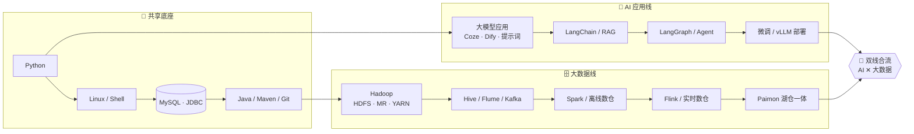

<!--
  jefere · GitHub Profile README
  可直接复制到 GitHub Profile 仓库（仓库名 = 用户名）的 README.md
  进度条为手动维护：每次完成一个阶段，改对应行的 ▰/▱ 与百分比即可
-->

<h1 align="center">Hi, I'm jefere</h1>
<h3 align="center">Python / JavaScript / Go · AI Learner · 大数据练级中 · Open Source Enthusiast</h3>

<p align="center">
  
</p>

<p align="center">
  
  
  
  
  
</p>

---

<a id="status" name="status"></a>

## 🎮 当前状态

| 冒险者 | 职业 | 主修 | 副修 |
|:---|:---|:---|:---|
| **jefere** `Lv.1` | 双修炼金术士 | AI 应用开发（RAG · Agent · 微调） | 大数据（Hadoop → Spark → Flink → 湖仓） |

| 当前副本 | 本周任务 | 经验值 |
|:---|:---|:---|
| W1 · 环境搭建与学习体系 | 装好 JDK / Python / 虚拟机，把两份大纲拆成可执行清单 | `▰▱▱▱▱▱▱▱▱▱` 8% |

<p align="center">
  
  
  
</p>

> 一个主号两条技能线：主线 **AI 应用开发**，副线 **大数据**，共享一个「Java / Linux / MySQL / Git」的底座。进度条会随着 commit 一起长大。

---

<a id="skill-tree" name="skill-tree"></a>

## 🧬 技能树



> 树是能从 `Python` 一路爬到 `湖仓一体` 的那种 —— 点开任意分支，都能落到一个真实项目上。

---

<a id="skill-panel" name="skill-panel"></a>

## 📊 技能点面板

图例：🟢 已解锁　🟡 练级中　⚪ 待解锁　·　点击「联动」跳到对应作品或阶段

### 🤖 AI 应用线

| 技能点 | 进度 | 状态 | 联动 |
|:---|:---|:---:|:---|
| Python 基础 | `▰▰▰▰▰▰▱▱▱▱` 60% | 🟢 | [siyuan-sireader](https://github.com/jefere9901/siyuan-sireader) · [rss-feed-reader](https://github.com/jefere9901/rss-feed-reader) |
| 提示词工程 | `▰▰▰▱▱▱▱▱▱▱` 30% | 🟡 | [提示词作品集](#works) |
| Coze / Dify 工作流 | `▰▱▱▱▱▱▱▱▱▱` 10% | 🟡 | [6 个电商 AI 应用](#works) |
| LangChain | `▱▱▱▱▱▱▱▱▱▱` 0% | ⚪ | [多模型调用封装](#roadmap) |
| RAG 检索增强 | `▱▱▱▱▱▱▱▱▱▱` 0% | ⚪ | [掌柜智库](#works) |
| LangGraph 图式编排 | `▱▱▱▱▱▱▱▱▱▱` 0% | ⚪ | [图式智能体](#roadmap) |
| Rasa 对话智能体 | `▱▱▱▱▱▱▱▱▱▱` 0% | ⚪ | [电商小二](#works) |
| 微调 / LoRA / vLLM | `▱▱▱▱▱▱▱▱▱▱` 0% | ⚪ | [私有模型服务](#works) |

### 🗄️ 大数据线

| 技能点 | 进度 | 状态 | 联动 |
|:---|:---|:---:|:---|
| Linux / Shell | `▰▱▱▱▱▱▱▱▱▱` 10% | 🟡 | [三节点集群模板](#roadmap) |
| MySQL / JDBC | `▰▰▱▱▱▱▱▱▱▱` 20% | 🟡 | [电商业务库](#works) |
| Java / Maven | `▰▰▱▱▱▱▱▱▱▱` 20% | 🟡 | [Maven 多模块工程](#works) |
| Hadoop（HDFS / MR / YARN） | `▱▱▱▱▱▱▱▱▱▱` 0% | ⚪ | [HA 集群](#works) |
| Hive / Flume / Kafka | `▱▱▱▱▱▱▱▱▱▱` 0% | ⚪ | [采集平台](#works) |
| Spark / 离线数仓 | `▱▱▱▱▱▱▱▱▱▱` 0% | ⚪ | [离线数仓项目](#works) |
| Redis / HBase | `▰▱▱▱▱▱▱▱▱▱` 10% | 🟡 | [Redis 缓存 demo](#roadmap) |
| Flink / 实时数仓 | `▱▱▱▱▱▱▱▱▱▱` 0% | ⚪ | [实时数仓 5.0](#works) |
| Paimon 湖仓一体 | `▱▱▱▱▱▱▱▱▱▱` 0% | ⚪ | [Paimon 湖仓项目](#works) |

### 🧱 共享底座

| 技能点 | 进度 | 状态 | 联动 |
|:---|:---|:---:|:---|
| Git / GitHub Actions | `▰▰▰▰▱▱▱▱▱▱` 40% | 🟢 | 你正在看的这个页面 🙂 |
| Docker / Compose | `▰▱▱▱▱▱▱▱▱▱` 10% | 🟡 | [容器化 API 服务](#works) |
| JavaScript / Vue3 | `▰▰▰▰▰▱▱▱▱▱` 50% | 🟢 | [siyuan-media-player](https://github.com/jefere9901/siyuan-media-player) |
| Go | `▰▰▰▰▱▱▱▱▱▱` 40% | 🟢 | [j-e-fe-re](https://github.com/jefere9901/j-e-fe-re) |

---

<a id="works" name="works"></a>

## 🏆 作品进度（点一下打勾，仪式感拉满）

- [x] 学习环境与双课程看板
- [ ] 客户信息管理系统（Python OOP 结业作）
- [ ] FastAPI 容器化 API 服务
- [ ] 6 个电商 AI 应用（Coze + Dify）
- [ ] 掌柜智库 · 企业级 RAG
- [ ] 电商小二 · Rasa 对话智能体
- [ ] 私有模型服务（LoRA + vLLM）
- [ ] 硅谷商城 · Vibe Coding 全栈
- [ ] 采集平台（用户行为 + 业务数据双链路）
- [ ] 离线数仓 · ODS→ADS 全链路
- [ ] 实时数仓 5.0 · Flink + Kafka
- [ ] Paimon 湖仓一体项目

> 做完一个就把 `[ ]` 改成 `[x]`，然后去 commit —— 这是唯一合法的自我奖励方式。

---

<a id="roadmap" name="roadmap"></a>

## 🗺️ 65 周 main quest

| 章节 | 关卡 | 状态 |
|:---|:---|:---:|
| Ⅰ | 共用底座（Python · Linux · MySQL · Java · Git） | 🟡 W1-W17 |
| Ⅱ | 大模型应用 → LangChain / RAG → Agent → 微调 | ⚪ W18-W33 |
| Ⅲ | Vibe Coding 全栈（SpringBoot + Vue3） | ⚪ W34-W38 |
| Ⅳ | Hadoop → Hive / Kafka → Spark → 离线数仓 | ⚪ W39-W52 |
| Ⅴ | Redis / HBase → Flink → 实时数仓 | ⚪ W53-W57 |
| Ⅵ | Paimon 湖仓 + AI 提效 | ⚪ W58-W59 |
| Ⅶ | 面试与作品集（Boss 战） | ⚪ W60-W65 |

<details>
<summary>👉 点开看「本周副本」详细任务（W1）</summary>

| 任务 | 奖励 |
|:---|:---|
| 装 JDK 17 / Python 3.11 / IDEA / PyCharm / VMware + CentOS | +20 XP |
| 建 Git 仓库与笔记库，确定目录规范 | +15 XP |
| 通读两份课程大纲，标注必学 / 选修 / 不做 | +25 XP |
| 把 65 周计划拆成本周 7 天任务 | +40 XP |
| **通关条件**：`java -version`、`python -V`、虚拟机 SSH 登录全部跑通 | 🏅 解锁「环境猎人」徽章 |

</details>

---

<a id="egg" name="egg"></a>

## 🥚 彩蛋

<details>
<summary>警告：点开后果自负</summary>

```text
    ╭──────────────────────────────────╮
    │  if (codeWorks) {                │
    │      dontTouchIt();              │
    │  }                               │
    │                                  │
    │  // 三天后：为什么又坏了？        │
    ╰──────────────────────────────────╯
```

**三个冷知识，证明我们是同类：**

1. 思源笔记插件的作者，最后都会变成「CSS 调试工程师」。
2. RSS 读者的终极困境不是没有源，而是 3000 条未读。
3. 学大数据的第一课不是 Hadoop，是「为什么我的虚拟机又连不上」。

<details>
<summary>再点一层，有真彩蛋 🎁</summary>

如果你也同时折腾 **思源插件 + RSS + AI**，那你大概率也在写一个「用 RAG 给笔记做语义搜索」的东西。
我先做了个雏形：[siyuan-sireader](https://github.com/jefere9901/siyuan-sireader) —— 欢迎来提 issue，或者来告诉我你的方案更好。

```text
技能点已加载：99%
人生进度条：░░░░░░░░░░ 不敢看
```

</details>

</details>

---

## 📈 GitHub Stats

<div align="center">
  
  
</div>

## 🔥 Streak

<p align="center">
  
</p>

## 🏅 Trophy

<p align="center">
  
</p>

## 🧰 Tech Stack

<p align="center">
  
</p>

## 📌 Featured Projects

<div align="center">
  <a href="https://github.com/jefere9901/siyuan-sireader">
    
  </a>
  <a href="https://github.com/jefere9901/siyuan-media-player">
    
  </a>
  <a href="https://github.com/jefere9901/rss-feed-reader">
    
  </a>
  <a href="https://github.com/jefere9901/j-e-fe-re">
    
  </a>
</div>

---

<p align="center">
  <i>Thanks for stopping by! 如果看到进度条动了，说明我又熬过了一个 23:30。</i>
</p>

<!--
  小提示：想让进度条自动长大，可以加一个 GitHub Action，
  读一个 progress.json（形如 {"week": 12, "ai": 3, "bigdata": 2}）后
  用脚本替换本文件中的 ▰/▱ 与百分比，再 commit 回来。
  想保留纯手工的仪式感，就每周自己改一格 —— 两种都很酷。
-->
